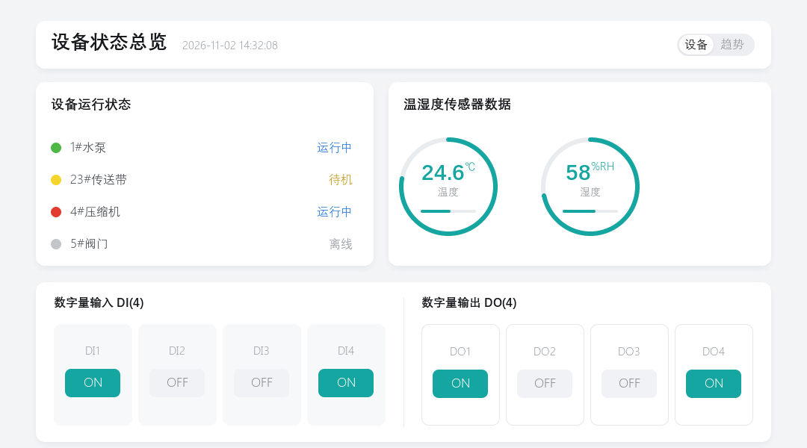

# device_status — LVGL Pro 示例工程（设备状态总览）

单屏工业设备监控面板，1080x600，可直接在 PC 模拟器中运行。



## 工程结构（LVGL Pro Editor 工程格式）

```
device_status/
├── project.xml                      工程定义：名称、target、分辨率
├── globals.xml                      全局资源：字体（中文）
├── screens/
│   ├── device_status_main.xml       界面 XML（编辑器里看到的就是它）
│   ├── device_status_main_gen.c/.h  由 XML 生成的 C 代码
├── fonts/                           6 个中文字体数据（<name>_default_data.c）
│   └── ttf/                         DengXian / Dengb（编辑器生成字体时读取）
├── device_status.c/.h               工程入口（device_status_init）
├── device_status_gen.c/.h           生成代码：字体指针、屏幕函数声明
├── file_list_gen.cmake              源文件清单
├── user_config.cmake                自定义源文件 + MSVC /utf-8 等配置
├── msvc_compat.h                    MSVC 兼容垫片
├── scripts/
│   ├── gen_fonts.py                 重新生成中文字体
│   └── shot_simulator.py            截取模拟器窗口（调试用）
└── sim/                             PC 模拟器（不影响嵌入式移植）
    ├── main.c  hal.c  hal.h
    ├── lv_conf_windows.defaults     Win32 后端配置
    ├── lv_conf_sdl.defaults         SDL2 后端配置
    └── CMakeLists.txt
```

## 运行

```bash
cd D:/LVGL_project/device_status

# 1) 配置（VS 版本按本机实际修改）
cmake -S sim -B build -G "Visual Studio 18 2026"

# 2) 编译
cmake --build build --config Debug --parallel

# 3) 运行
build/bin/lvgl_simulator.exe
```

或直接双击 `run.bat`。

- LVGL 默认复用 `../examples/build/_deps/lvgl-src`（v9.5.0），没有则自动从 GitHub 拉取。
  可显式指定：`-DLVGL_LOCAL_DIR=<lvgl 源码目录>`。
- 窗口 1080x600。Windows 缩放 150% 时窗口会被系统放大，属正常现象。

## 界面构成

| 区域 | 内容 |
|---|---|
| 标题栏 | 设备状态总览 + 时间 + `设备/趋势` 分段控件 |
| 设备运行状态 | 4 台设备（水泵/传送带/压缩机/阀门）状态圆点 + 状态文字（运行中/待机/离线） |
| 温湿度传感器数据 | 两个 `lv_arc` 环形仪表，内含数值、单位、说明和底部进度细条 |
| 数字量输入/输出 | 第 3 行整行铺满：DI1~DI4 只读显示 ON/OFF，DO1~DO4 用 `lv_button` 点击切换 ON/OFF |

所有坐标按 1080x600 绝对定位，`screens/device_status_main.xml` 与
`screens/device_status_main_gen.c` 一一对应，改完 XML 用编辑器 Regenerate 即可。

## DO 开关逻辑

DO1~DO4 在 XML 里是 `lv_button`，每个瓦片里有一个名为 `doN_state` 的状态胶囊
和它的 `lv_label`。点击行为在 `device_status.c` 里：

```c
lv_obj_t * screen = device_status_main_create();
device_status_io_init(screen);   /* 绑定 do1..do4 的 LV_EVENT_CLICKED */
lv_screen_load(screen);
```

回调读当前标签文字（`ON`/`OFF`）取反，再同时切换胶囊底色（青 `0x16a6a1` / 灰
`0xf0f2f5`）和文字颜色。初始状态就写在 XML 的 `text="ON|OFF"` 上，不用另外初始化。

> `sim/main.c` 已在 `lv_screen_load()` 前调用 `device_status_io_init()`；
> 自己写 main 时别忘了这一步，否则按钮点击无反应。

## 中文字体

LVGL 内置字体不含汉字，工程用 Windows「等线 / 等线 Bold」烘焙了 6 档字体：

| 资源名 | 尺寸 | 用途 |
|---|---|---|
| `font_title` | 26 bold | 页面标题 |
| `font_value` | 30 bold | 环形仪表数值 |
| `font_h3` | 18 bold | 卡片标题 |
| `font_h4` | 16 bold | 分区标题 |
| `font_body` | 16 | 正文 |
| `font_small` | 14 | 表头 / 说明 / 单位 |

只包含界面实际用到的字形（62 个非 ASCII 字符 + ASCII），6 个文件合计约 750 KB。

**改动了界面文字后要重新生成字体**，否则新字会显示成方框：

```bash
python scripts/gen_fonts.py
```

脚本会：扫描 `*.c/*.h/*.xml` 收集所有非 ASCII 字符（`°` 也包含）→ 把字符表写回
`globals.xml` 的 `range` / `symbols` → 调用 `npx lv_font_conv` 输出到 `fonts/`。需要 Node.js。

> **坑：编辑器会自己重建字体，并清掉中文字形**
>
> LVGL Pro Editor 在 Regenerate / 构建预览时会按 `globals.xml` 的字体定义重新生成
> `fonts/*_default_data.c`。若 `<bin>` 没写 `symbols`，编辑器只烘焙 `0x20-0x7F`，
> 于是所有汉字从字体里消失 —— 预览界面看起来“一个字都没有”（拉丁字母数字仍在）。
>
> 判据：`fonts/font_title_default_data.c` 头部 `Opts:` 行里没有 `--symbols`，
> 或文件里的 `.list_length` 为 0，就是被覆盖了。修复：`python scripts/gen_fonts.py`。
>
> 现在 6 个 `<bin>` 都带上了 `range="0x20-0x7F" symbols="…"`，编辑器再生成时不会丢字。

## 中文不显示的三类原因（按症状区分）

| 症状 | 原因 | 处理 |
|---|---|---|
| 汉字整条消失、英文数字正常 | 字体里没有 CJK 字形（`globals.xml` 缺 `symbols`，被编辑器按 ASCII 重烘） | 跑 `python scripts/gen_fonts.py` |
| 汉字变乱码 / 方块 | 源文件被按 GBK 解析（`C4819`、`C2001` 换行符报错） | 源文件保持 UTF-8 无 BOM；MSVC 加 `/utf-8`；emcc/clang 默认 UTF-8 |
| 预览编译报 `'lvgl.h' file not found` | 字体 .c 用了 `--lv-include lvgl.h`，而预览的头文件在 `libs/include/lvgl/lvgl.h` | 烘焙时不要传 `--lv-include`，用 lv_font_conv 默认的 `lvgl/lvgl.h` |

自查一条命令：

```bash
grep -m1 "Opts:" fonts/font_title_default_data.c   # 要有 --symbols，且没有 --lv-include lvgl.h
grep -c "list_length = 0" fonts/*_default_data.c   # 中文为 0 就是没烘焙进去
```

预览的 wasm 里字体对象是否变大，也可以用来确认预览确实用上了新字体：
`preview-build/project/CMakeFiles/lib-ui.dir/fonts/*.o` 单个从 6~15 KB 涨到 12~40 KB 即正常。

## 说明

- `screens/device_status_main_gen.c`、`device_status_gen.c/.h` 由 LVGL Pro Editor 从 XML
  重新生成，已与 XML 同步；改动请落在 XML 上，再让编辑器 Regenerate。
- 字体数据文件命名为 `<字体名>_<target>_data.c`（target 为 `default`），
  `device_status_gen.c` 以 `font_title_default_data` 这类符号引用它们。
- `globals.xml` 的 `src_path` 必须是工程内相对路径（见上表），TTF 已放在 `fonts/ttf/`。
- 参考图中被 AI 生成图片打乱的文字已按语义修正：
  `设备运态状态`→`设备运行状态`、`DI DI(4)`→`DI(4)`、`DD2`→`DO1`、
  `2026-16 16`→`2026-11-02`。

## XML 写法注意（编辑器校验严格）

| 不要写 | 原因 | 替代 |
|---|---|---|
| `align="out_right_mid"` | `align` 只接受 9 种基准对齐 (`top_left`/`center`/`right_mid`…) | 用绝对 `x`/`y`，或让父容器 flex 排布 |
| `radius="100%"` | 圆角只接受像素值 | 写大数 `radius="999"` 表示全圆 |
| `style_text_letter_space` | 未在 widget 属性中开放 | 放在 `<style>` 块里，或直接省略 |
| `src_path="C:/Windows/Fonts/..."` | 编辑器按 `<项目>/<src_path>` 拼接，绝对路径会变成 `d://proj//C://Windows//...` → `ENOENT` | TTF 复制进 `fonts/ttf/`，写相对路径 |
| 容器不写 `scrollable="false"` | `lv_obj` 默认可滚动，按钮/徽标里会冒出竖滚动条 | 所有 `<lv_obj>` 加上 `scrollable="false"` |
| 不处理 `<arc>` 的 knob | 环形仪表左下角出现蓝色小圆点 | 加 `<style selector="knob" bg_opa="0%" .../>` |
| 样式名与对象名相同 | 生成的 C 里 `lv_style_t seg_active` 与 `lv_obj_t * seg_active` 同名遮蔽，`lv_obj_add_style` 收到对象指针 → 崩溃 | 两者用不同前缀（`style_xxx` / `xxx`） |
